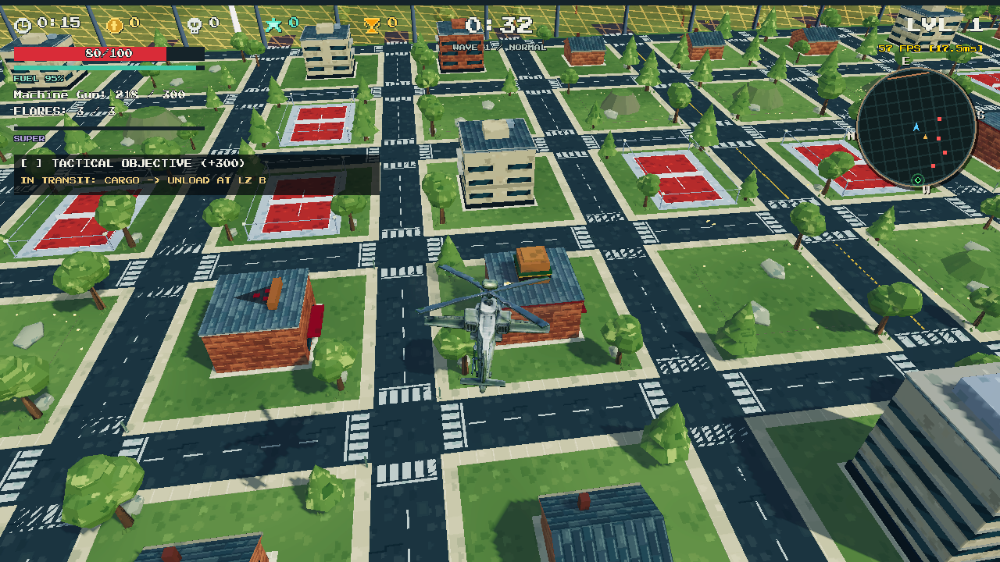
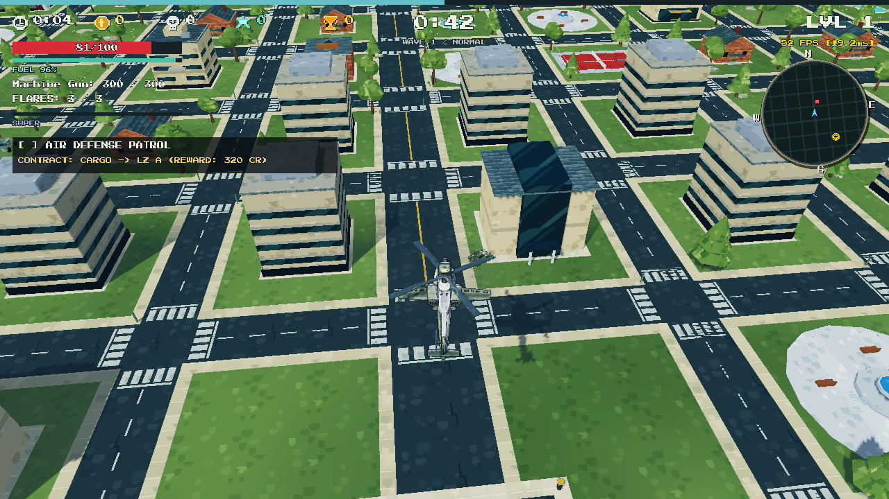
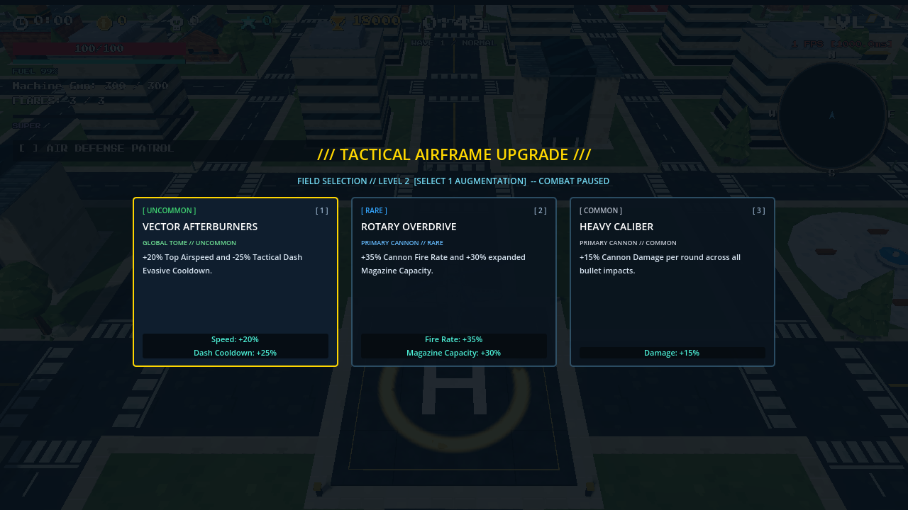
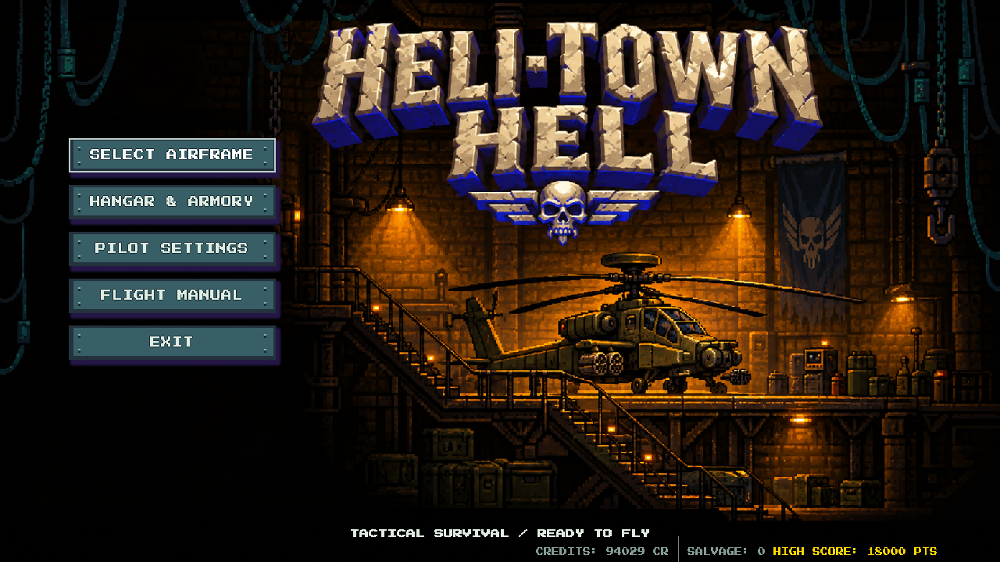

# ZIVA: Heli-Town Hell

**Fly low. Hit hard. Survive the next wave.**

A 3D helicopter combat roguelite built in Godot. Take an attack helicopter over a stylized low-poly town, fight escalating ground and air threats, collect XP, and build your loadout through upgrade drafts.



> Active development · Single-player · Godot 4.7.1 · GDScript · Compatibility renderer

## The sortie

- **Pilot your own attack helicopter.** Turn, strafe, climb, dive, and dash while aiming your weapons independently.
- **Build a combat loadout.** Switch weapons, reload, paint salvo targets, deploy flares, and trigger your Devastation Super.
- **Survive escalating waves.** Fight mobile ground vehicles, aircraft, support drones, and a heavy gunship boss while managing tactical objectives.
- **Collect XP and choose upgrades.** Physical pickups feed run progression; each gained level grants an upgrade selection that affects the actual aircraft or weapon systems.
- **Return to the hangar.** Choose an airframe and spend earned credits and salvage on persistent upgrades.
- **Read the battlefield.** A tactical minimap, weapon readouts, threat cues, and pickup feedback keep the action visible above the town.

## Gameplay gallery

Screenshots captured from development builds. Visuals and balance continue to evolve.

### Town flight



### Choose your next upgrade



### Operations center



## Play from source

The project is configured for **Godot 4.7.1**, using the **GL Compatibility** renderer and **Jolt Physics**. Use the standard Godot editor; the game is written in GDScript and does not require .NET.

Install [Godot](https://godotengine.org/download/) and [Git LFS](https://git-lfs.com/), then clone the project:

```bash
git lfs install
git clone https://github.com/ArnavNah/Ziva-HELI-TOWN-HELL.git
cd Ziva-HELI-TOWN-HELL
git lfs pull
```

1. Import `project.godot` in Godot.
2. Let the editor finish importing textures, models, and other resources.
3. Press **F6** with a specific scene open to test it, or **F5** to launch the full game from the main menu.
4. Select an airframe and deploy. The in-game **Flight Manual** lists the configured bindings.

If the Godot executable is available as `godot` on your PATH, you can also launch with:

```bash
godot --path .
```

Large asset files are stored with Git LFS. If a model or texture appears as a small text pointer after cloning, run `git lfs pull` before importing. Some editable source models are `.blend` files; Godot's direct Blender import requires Blender to be installed and configured in the editor. Runtime vehicle rigs also include exported GLB models and Godot mesh resources.

## Controls

| Action | Keyboard / mouse |
| --- | --- |
| Forward / brake and reverse | **W / S** or **Up / Down** |
| Turn left / right | **A / D** or **Left / Right** |
| Strafe left / right | **Q / E** |
| Climb | **Space** or **Shift** |
| Descend | **Ctrl**, **C**, or **Z** |
| Evasive dash | **Alt** or **X** |
| Aim | **Mouse** |
| Fire selected weapon | **Left click** or **J** |
| Paint salvo targets / release salvo | **Hold / release right click** |
| Select weapon | **1–4** or **Mouse wheel** |
| Reload | **R** |
| Deploy flares | **F** |
| Devastation Super | **V** or **G** |
| Choose an upgrade card | **1–3** while the draft is open |
| Toggle minimap size | **M** |
| Pause | **Esc** or **P** |

Gamepad bindings are also configured. See the Flight Manual for the full list.

## Aircraft

| Airframe | Flight style |
| --- | --- |
| **AH-64 Apache** | Balanced assault helicopter |
| **RAH-66 Nighthawk** | Faster, more agile reconnaissance airframe with lighter armor |
| **MI-28 Warlock** | Heavy gunship with greater hull and fuel capacity |

## Active ground opposition

Seven ground vehicles are currently enabled. Their visual rigs include animated movement and independently aimed weapons.

| Vehicle | Role |
| --- | --- |
| Scout Buggy | Light reconnaissance vehicle with rapid dual bursts |
| Assault APC | Four-wheeled armored carrier with autocannon bursts |
| Azure Siege Tank | Long-range rail cannon |
| Desert Ironclad | Heavy conventional artillery cannon |
| Ironclad Sentinel | Rotary autocannon platform |
| Raptor Raider | Mobile four-wheeled cannon raider |
| Desert Barrage Rover | Six-wheeled missile platform with eight launch outlets |

Legacy ground types remain in the source for reference and are disabled in the production spawner. Air-vehicle prompt documents are design references; they do not define which enemies are enabled in gameplay.

## Project map

| Path | Contents |
| --- | --- |
| `project.godot` | Project configuration and autoloads |
| `scenes/` | Game, UI, player, and reusable enemy scenes |
| `src/player/` | Flight, weapons, pickups, and run progression |
| `src/enemies/` | Enemy specifications, spawning, AI, and articulated vehicle controllers |
| `src/combat/` | Projectiles and damage |
| `src/ui/` | Menus, HUD, minimap, and upgrade selection |
| `autoload/` | Shared run state, input, profile, audio, and UI services |
| `data/` | Aircraft specifications and game constants |
| `assets/Enemy/` | Enemy source models, textures, and mesh resources; capitalization matters |
| `tests/` | Godot verification scripts and regression checks |
| `tools/` | Asset inspection and development utilities |
| `docs/` | Integration notes, art prompts, and screenshots |

Wheeled ground vehicles share one wheel mesh and material with per-vehicle mounts and animation settings. The tanks use enclosed running gear. For development conventions and progression rules, read [AGENTS.md](AGENTS.md).

## Development checks and export

Tests are standalone Godot scripts. Run the checks relevant to your changes, for example:

```bash
godot --headless --path . --script res://tests/test_enemy_combat_intelligence.gd
godot --headless --path . --script res://tests/verify_enemy_pursuit.gd
```

Import the project first. Mechanical animation, camera readability, and effects also need an in-game visual check.

A **Windows Desktop** export preset is included. Install the matching Godot export templates and export through **Project → Export**, or run:

```bash
godot --headless --path . --export-release "Windows Desktop" build/HeliTownHell.exe
```

Create `build/` first when using the command line. Generated builds, editor caches, local audit captures, and the optional local AI-agent add-on are excluded from version control.

## Asset rights

The repository includes game code, original project work, and supplied art assets. No blanket open-source license is granted by this README. Check individual asset terms and obtain permission before redistributing or reusing project content.
