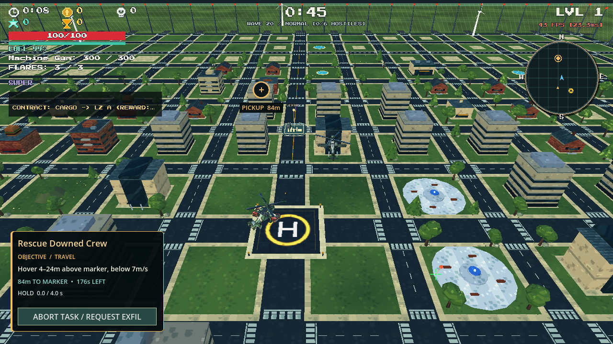

# Air pursuit and aiming — 5 November 2026

Completed the follow-up to the air-targeting changes in `7b1837b` and verified the current production controllers.

## Behavior

Aircraft turn toward their target even when hovering or holding position. Gunships and fixed-gun aircraft face the predicted/committed firing point through setup and attack; the elevation controller can track a low-flying player. Fixed guns require a valid forward firing arc, and rejected shots do not consume their burst/outlet count. Fighters retain attack passes, peel away and then reacquire the player. Rocket gunships maintain a standoff position with proportional movement rather than oscillating around a full-speed waypoint. Bombers make flyovers and minelayers close onto the player's flight corridor before crossing it.

The final continuation fixed a separate entry bug: the shared pursuit controller had been commanding full approach speed even after a close-spawned aircraft reached its engagement band. During its two-second protection period that could carry it into the player. It now holds its engagement distance while continuing to turn and aim. Obstacle avoidance and altitude clearance remain active.

The role-specific breakaways intentionally turn away briefly before re-engaging. A bomber's nose follows its flight path while its payload drops from the belly; a minelayer crosses the flight corridor to place hazards. Their payload behavior remains distinct from forward-firing gunships.

## Fresh verification

**473 checks passed across seven suites**:

| Suite | Passed |
|---|---:|
| Air pursuit/facing regression | 79 |
| Full air integration | 174 |
| Combat director regressions | 46 |
| Enemy combat intelligence | 6 |
| Regular wave roster/Titan escorts | 39 |
| XP and real upgrade effects | 65 |
| Seven ground vehicles, rendered | 64 |

The 79-check suite uses all nine modeled regular air roles. It checks opposite-heading hover turns, steep downward aiming, rejected fixed-gun shots and burst accounting, safe protected-entry distance, live approach from long range, reacquisition after the player changes position, corridor crossings, and real projectile/mine emission after pursuit and warning. The new close-entry cases maintain more than 20 units of planar separation at a 22-unit test spawn while continuing to face the player during protection. Tests use a fixed random seed and isolated save directories.

The original pre-fix test reproduced failed hover-facing checks in all nine roles. The fresh tests now pass those checks as well as the additional close-entry and low-altitude cases. Final named test logs contain no script errors.

## Town gameplay observations

`tests/capture_air_pursuit.gd` runs the actual generated town, production aircraft models/controllers, chase camera, and combat HUD. It samples each of the nine roles six times over twelve simulated seconds, moving the player's position sideways during each encounter. It records actual distance, facing alignment, behavior state, and committed shot/drop outlets in `city-pursuit.json`. All nine roles produce actual attacks or payload drops during the recorded encounters.

The ordinary images use the gameplay chase camera. Supplemental `*-inspection.png` images temporarily frame both live actors with an observer camera to inspect the visible model direction. This camera is restored before the next simulation tick and does not change the enemy's movement/aim commands. Player repositioning and encounter placement are staged; this is not a human-played control-feel or full-run balance assessment. The screenshots are not a frame-rate benchmark.



All artifacts are under the Git-ignored `artifacts/air-pursuit-fix-2026-11-05/`: suite logs, 54 chase-camera samples, supplemental inspection images, and the gameplay JSON. The supplied source models, seven enabled ground roles, regular-wave drone exclusions, Titan escorts, attack permissions, warning flow, projectile sockets and authoritative physical XP collection remain in use.

## Reproduce

Set `ZIVA_TEST_DATA_DIR` to a disposable save directory before starting Godot:

```text
Godot.exe --headless --path . --script tests/test_air_pursuit_and_facing.gd
Godot.exe --headless --path . --script tests/test_air_enemy_integration.gd
Godot.exe --path . --script tests/capture_air_pursuit.gd
```
