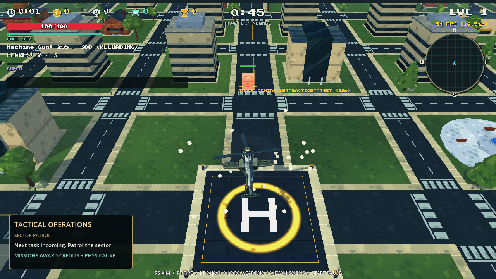
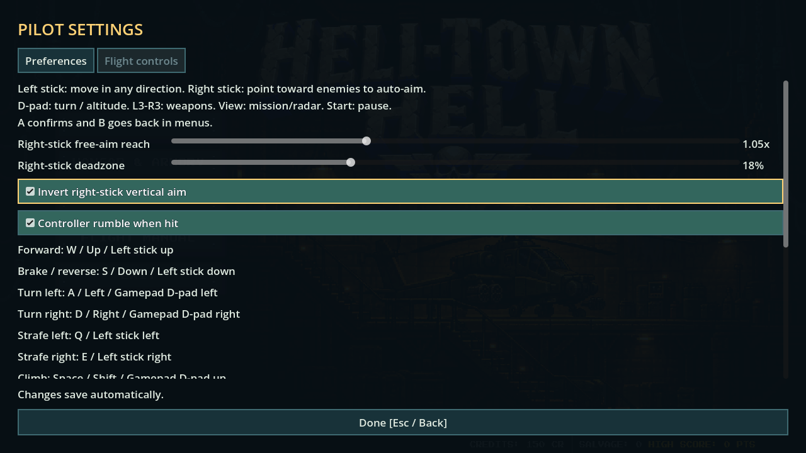

# Controller movement, directional aim and rumble — 30 October 2026

The left stick now translates the helicopter in the direction shown on screen. Left/right no longer rotates the helicopter and camera; manual turning moves to D-pad left/right. D-pad up/down retains climb/descent. Keyboard A/D turning and Q/E strafing remain available.

Controller translation uses camera-relative movement, normalizes diagonal input, and gives sideways and backward movement the same cruise-speed authority as forward movement. Sideways acceleration responds promptly, with stronger braking and reversal for dodging. Aircraft speed caps, cargo/engine modifiers, keyboard handling, and visual bank remain in the existing flight controller.

The right stick now expresses an aim **direction**, rather than moving a cursor that the player must drag precisely onto an enemy. Visible, reachable enemies in a 28-degree directional cone receive aim assistance; the current target has a 38-degree retention cone. A small hysteresis bonus stabilizes selection. Sweep the stick toward another enemy to switch; release it to retain the direction and track the target. Buildings, dead/freed enemies, offscreen targets and mechanical gun limits are respected. Without a valid target, the gun free-aims in that direction. Mouse aiming retains its existing cursor selection.

The HUD reticle follows the assisted target. The turret and salvo painter share that point, so right-stick aiming also supports holding/releasing LT to paint and launch real homing salvos. Aim queries never advance alternating firing barrels.

Accepted hull hits and shield absorption request short damage-scaled controller pulses, approximately 0.12–0.28 seconds, on the active controller device. Protected or evaded hits do not produce damage rumble. Pausing, leaving gameplay, disconnecting, switching to mouse, or disabling rumble stops it. Settings → Flight controls now includes **Controller rumble when hit**, enabled by default and persisted with existing preferences. The old sensitivity preference now adjusts free-aim reach; deadzone and vertical inversion remain available.

## Current mapping

| Control | Action |
|---|---|
| Left stick | Camera-relative movement in any direction |
| Right stick | Directional auto-aim; free aim when no valid target |
| D-pad left/right | Turn helicopter |
| D-pad up/down | Climb/descend |
| RT | Fire |
| LT hold/release | Paint/launch salvo |
| L3/R3 | Previous/next weapon |
| LB | Flares |
| RB or B | Dash during combat |
| X / Y | Reload / super |
| View / Start | Mission actions / pause |

## Checks actually run

Tests use real Godot joypad events from synthetic device **7**, isolated test saves, the real helicopter flight code, turret, collision queries, UI and damage entry points.

| Suite | Result |
|---|---|
| `tests/test_controller_handling.gd` | **21/21**: real translation without yaw; prompt acceleration; reversal within 250 ms; symmetric left/right response; braking; diagonal cap; camera-relative movement after heading change; imprecise directional acquisition; shared reticle; target switching/tracking; obstruction/death rejection; bounded active-device rumble; shield/protection/pause/preference behavior |
| `tests/test_controller_ready.gd`, headless | **71/71**: full menu/sortie/combat/salvo/pause/cards/extraction/retry flow |
| `tests/test_helicopter_lateral_handling.gd` | **16/16**: existing keyboard/override handling, symmetry, coasting, reversal bounds, frame rates and all aircraft turn behavior |
| `tests/test_xp_upgrade_effects.gd` | **65/65**: progression, real controller upgrade effects and restart |
| `tests/test_gameplay_stability_and_upgrades.gd` | All repair/upgrade transaction and damage/protection checks passed |

Logs are under `artifacts/controller-handling/`. The complete controller flow reports five ObjectDB instances at exit; it passes all assertions without runtime script errors. This shutdown leak remains recorded rather than represented as fixed by the handling changes.

Rendered captures from the real controller flow:

No physical gamepad is attached to this execution environment. Device selection, damage routing, pulse parameters and cancellation were tested through synthetic input; motor feel and controller-driver vibration support still need a hands-on hardware check. Native vibration is sent only to an actually connected active pad.

The prior air-enemy integration, assets and verification are included in the same project update; see [air integration results](AIR_ENEMY_INTEGRATION_RESULTS_2026-10-30.md).
