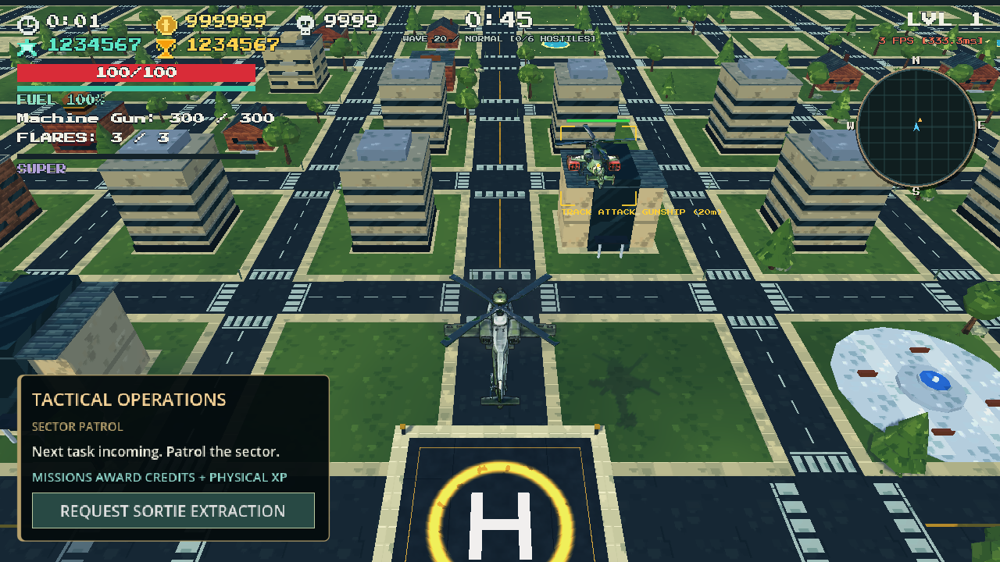
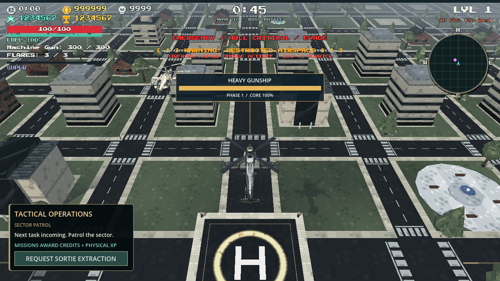

# Controller and presentation fixes — 4 November 2026

Implemented the remaining issues from the controller/presentation review in the existing game.

## Player-visible changes

- The left stick's radial deadzone now applies to the final flight command. Pad axes no longer enter the keyboard fallback, including noise from an inactive controller. The helicopter remains stationary inside the deadzone through normal physics processing.
- Movement and aiming have separate ownership. Deliberate mouse aiming works while the left stick moves the helicopter; the right stick restores directional auto aim. Mouse arbitration uses physical pixels, so window stretching cannot turn small mouse jitter into a mode change. Right-stick input is device-scoped, and focus loss clears cached movement and rumble.
- Target brackets follow current visible hull bounds. Fallback compound collision shapes include their actual position, rotation and scale. Cached source references avoid repeated scene searches; current transforms prevent stale poses. Near-plane clipping and screen bounds prevent invalid or oversized projected UI.
- The animated hull/turret mount is applied before gimbal aiming and impact raycasts. Current muzzle direction and the cached aim direction agree after bank/pitch changes. Target labels are larger and kept inside the viewport.
- Camera framing is wider: the baseline uses distance 40, height 36 and FOV 52. Each airframe receives square-root compensation for its configured model scale, preserving the lighter/heavier variants while keeping comparable screen occupancy. Speed pull-back remains four units and existing collision occlusion recovery remains active.
- Hull collider dimensions and turret-mount offsets follow each airframe's configured visual scale exactly once. Repeat configuration does not compound scaling.
- Flight presentation uses saved rest transforms. Nighthawk's attitude response is 1.20x the baseline; Warlock's is 0.86x. Lateral acceleration contributes to banking, braking counter-bank remains, vertical flight has a restrained cue, and hover offset is bounded below 15 cm and blends away on landing. Visual motion remains separate from the collision root and 360-degree movement vector.
- Main/tail rotor phase is bounded and rebuilt from the saved basis. Exact integration of RPM spool response produces matching elapsed-time phases at 30/60/120 FPS while keeping shaft positions fixed.
- Settings now include **HUD and text size**, from 1.00x to 1.25x. It scales the survival cluster, mission briefing and boss panel without scaling world-projected targeting controls. Critical survival text is larger. The stats/timer repair survives long values at both sizes; missile/emergency, border and boss information use separate vertical lanes.





## Vehicle-scale policy and audit

The reproducible audit covers **22 entries**: three player airframes, seven active ground roles, nine regular air roles and three real director-routed bosses. Raw measurements are in [the vehicle scale CSV](VEHICLE_SCALE_AUDIT_2026-11-04.csv). Hull bounds exclude separately named rotors and blur/cue geometry; the full mesh column is a conservative sampled envelope. It is not a flight-clearance or exact blade-swept-volume measurement.

Retained the existing ground and enemy model proportions after comparison: buggies remain light and small, armored vehicles are wider/longer, bomber wings are broader than fighter wings, and the modular Titan retains its much larger footprint. Adjusted the player's camera presentation and per-airframe physical alignment rather than introducing distance-dependent object scaling or enlarging every opponent. All physical actor roots remain at unit scale. Enemy mounts, outlets, elite scaling, AI, wave budgets, enabled roster and shared wheel resources are preserved.

The player models share the supplied body with configured scale factors 0.92/1.00/1.08. At the common comparison framing their measured projected hull sizes are approximately 147x170, 161x185 and 176x199 logical pixels. Normal gameplay uses each variant's own compensated camera. These measurements describe staged comparisons, not a guarantee of constant pixel dimensions while distance, attitude or occlusion changes.

The imported `Helicopter_Body` combines wings and landing gear into one mesh. Removed the obsolete procedural wing/skid hooks instead of claiming independent movement that the asset cannot display. The real body and two independent rotor meshes supply the verified animation. Separate gear/wing articulation would require an asset-authoring change and is not claimed here.

## Verification

**905 checks passed across 15 suites** using Godot 4.7.1 and isolated `ZIVA_TEST_DATA_DIR` saves:

| Suite | Passed |
|---|---:|
| Presentation completion regressions | 36 |
| 360-degree controller movement | 56 |
| Controller handling | 21 |
| Complete controller/menu/combat flow | 71 |
| Lateral handling | 16 |
| Flight render-rate matrix | 87 |
| Gameplay stability and upgrade transactions | 20 |
| Real XP upgrade effects | 65 |
| Altitude/collision/damage feedback | 8 |
| Playability game-loop smoke | 20 |
| Air integration | 174 |
| Regular-wave roster | 39 |
| Director regressions | 46 |
| Menu repair | 182 |
| Seven ground vehicles, rendered | 64 |

The new 36-check suite reproduces the final-command deadzone/device leak, runs a live stationary physics sequence, checks mouse/pad aim handoffs and neutral packets, exercises offset/rotated/scaled compound bounds and near-plane clipping, verifies current-pose aiming, tests landed/hover offsets, measures rotor phase and shaft stability, confirms all airframe collider configurations, persists HUD scaling and verifies focus-loss reset.

Rendered checks use the real generated town and production HUD/camera at 960x540, 1280x720, 1920x1080, 1024x768 and 2560x1080, at 1.00x and 1.25x HUD size. Long-value stats do not overlap the wave timer in all ten configurations. Bosses are created through their actual Town/Desert/Harbor director routes; visible boss panels are checked against the warning lane. Boss positions, warning phases and large score values are staged deliberately for inspection.

A normal physics/process sequence records 36 circular movement samples with independent right-stick aiming and actual firing. Captured ammunition changes confirm firing occurred. This is a short synthetic-input demonstration, not a human-played run or a full balance assessment. An XInput controller was detected by the rendered runner; no hands-on motor/driver feel test is claimed.

Final named test and capture logs contain no script errors. The known five-ObjectDB-instance exit warnings remain in a few older UI/loop suites. The invalid-upgrade warning in the transaction test is intentional. This change does not claim to fix all engine shutdown warnings or guarantee 60 FPS; staged screenshot frame counters include capture work and concurrent checks and are not a performance benchmark.

## Reproduce

After normal Godot import, set `ZIVA_TEST_DATA_DIR` to a disposable save directory and run:

```text
Godot.exe --headless --path . --script tests/test_presentation_completion.gd
Godot.exe --headless --path . --script tests/test_controller_360_movement.gd
Godot.exe --path . --script tests/capture_presentation_completion.gd
Godot.exe --path . --script tests/test_seven_ground_vehicles_integration.gd
```

Capture output is written under `artifacts/presentation-fixes-2026-11-04/`, including the 22-entry scale/motion JSON, ten HUD images, three boss images, flight frames and final regression logs. `flight-motion.gif` is a local preview assembled from the recorded frames. The screenshot fixture uses explicit test spawns for roster inspection and real director routes for bosses; it does not enable disabled roles in regular waves.
